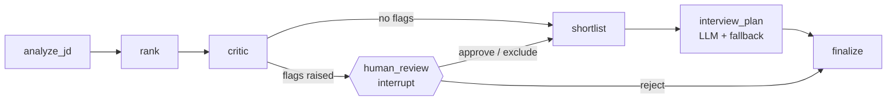

# Hiring Agent

A resume-screening **workflow** built with LangGraph, with a human-in-the-loop checkpoint, an **MCP server** that exposes its tools, and a **FastAPI** service around it. Runs fully offline by default; an LLM is optional.



## What is real here, and what is not

| Piece | What it actually is |
|---|---|
| `analyze_jd`, `rank` | Deterministic tool calls (extract skills, weighted scorecard). Run in-process or over MCP. |
| `critic` | A **rule-based** reviewer, not an LLM. Flags keyword stuffing (skills only in a bare list), a close call at the shortlist cutoff, and a JD with too few known skills. |
| `human_review` | A real LangGraph `interrupt`. The run pauses, is checkpointed, and resumes with a person's decision, even after the process restarts. |
| `interview_plan` | The only LLM step. If the LLM errors or returns fewer than 5 numbered questions, a template fallback is used, so a plan is never short or empty. |

This is a multi-step workflow with specialised roles, not a set of autonomous LLM agents. The design goal is that the risky decisions (who is excluded) stay with a human and everything else is reproducible.

## MCP server

`hiring_agent/mcp_server.py` exposes `extract_skills` and `score_resumes` over MCP (built on the `mcp` 2.x `MCPServer`). Use it from Claude Desktop (`examples/claude_desktop_config.json`) or any MCP client. The workflow can call its tools over MCP by setting `MCP_SERVER_URL`; a test asserts the results are identical in-process and over MCP. Inputs are validated (max 50 resumes, 20,000 characters each).

## API

```bash
pip install -e ".[dev]"
uvicorn hiring_agent.api:app_factory --factory --port 8000
```

| Endpoint | Purpose |
|---|---|
| `POST /screenings` | Run a screening. Returns `completed` or `awaiting_review` with the critic's flags. |
| `GET /screenings/{id}` | Current state, ranking with per-signal breakdown, shortlist, interview plans, trace. |
| `POST /screenings/{id}/review` | Resume a paused run: `{"approve": true, "exclude": ["name"], "note": "..."}`. 409 if not waiting. |
| `GET /health` | Liveness. |

Config: `API_KEY` (require `X-API-Key`), `CHECKPOINT_DB` (SQLite file, default `checkpoints.db`), `MCP_SERVER_URL`, `GEMINI_API_KEY` and `GEMINI_MODEL` (optional real LLM via `pip install -e ".[llm]"`).

Docker: `docker build -t hiring-agent . && docker run -p 8000:8000 -v hiring-data:/data hiring-agent`

Try it without the API: `python examples/demo.py`.

## Tests

```bash
pytest -q        # 41 tests, no network, no API keys
```

Covered: scoring and blind mode, each critic rule, the graph's clean path, pause, approve, reject, exclusion, garbage resume values, no resumes, thread isolation, broken and junk LLM output, the MCP server's tools and validation, MCP vs in-process equivalence, every API route and validation case, API key enforcement, and a screening that stays resumable across an app restart with the real SQLite checkpointer. The stdio transport and a live uvicorn server were also smoke tested by hand.

## Limitations

- Scoring is a keyword and TF-IDF scorecard (no embeddings here), built to prioritise human review. It was not validated on real hiring outcomes.
- Blind mode removes obvious identifiers only. Hiring tools are regulated in some places (for example NYC Local Law 144, the EU AI Act). Audit outcomes before any real use and never auto-reject.
- No authentication beyond an optional shared API key, no rate limiting, and resume text is stored in the checkpoint database. Treat it as a prototype for personal data.
- The Gemini path (`GeminiLLM`) is not exercised in CI because it needs a key.
